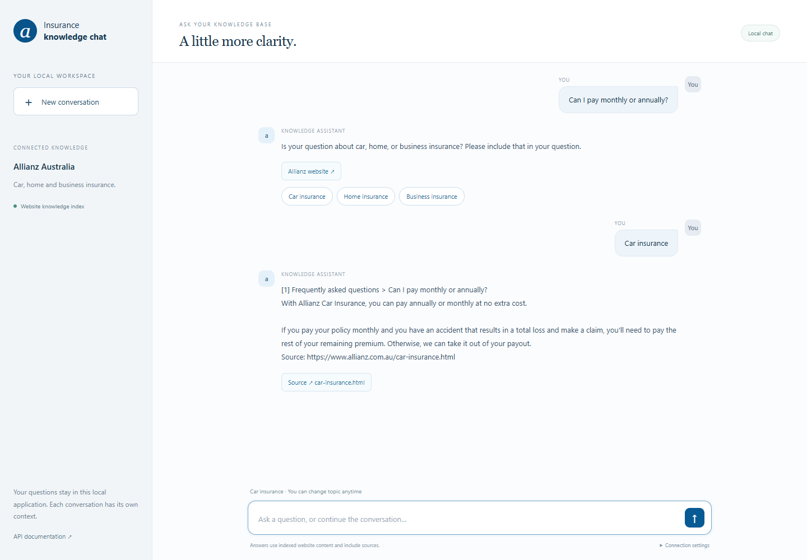
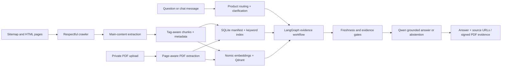

# Evidence-First Insurance RAG

[](https://github.com/tarunkumaryadav-ai/evidence-first-insurance-rag/actions/workflows/ci.yml)
[](https://www.python.org/)
[](#local-models)
[](#validation)

A production-oriented, local-first retrieval-augmented generation system for
answering questions from public insurance content. It combines controlled web
ingestion, hybrid retrieval, deterministic query routing, a LangGraph evidence
workflow, grounded generation, and source URLs in every supported answer.



## Why this project matters

Most RAG demos stop at embedding a few documents and calling an LLM. This project
focuses on the engineering needed for a maintainable knowledge system:

- **Grounded answers:** unsupported responses abstain instead of inventing policy details.
- **Hybrid retrieval:** Qdrant semantic search is combined with SQLite keyword search.
- **Incremental ingestion:** sitemap `lastmod`, content hashes, and active revisions avoid unnecessary reprocessing.
- **Structured metadata:** every chunk carries product, category, variant, sub-product, source URL, and freshness data.
- **Conversational clarification:** ambiguous questions are narrowed before retrieval while follow-up context is retained.
- **Local inference:** Ollama runs both the Qwen LLM and Nomic embedding model without a paid API.
- **Private PDF evidence:** upload text PDFs, retain page metadata, and open a short-lived signed evidence viewer with the cited passage highlighted beside the exact PDF page.
- **Operational controls:** crawl pacing, robots checks, bounded context, API authentication support, health/status endpoints, locks, and reproducible dependency pins.

## Verified implementation snapshot

| Measure | Result |
| --- | ---: |
| Discovered sitemap entries | 512 |
| In-scope car, home, and business pages | 192 |
| Indexed chunks | 2,703 |
| Offline automated tests | 121 passing |
| Ingestion errors in the recorded full run | 0 |

The corpus figures describe a local run completed on 11 November 2026 and are not
bundled in this repository. Crawled pages, databases, vectors, exports, and model
weights are deliberately excluded. See [VALIDATION.md](VALIDATION.md) for the
recorded checks and [docs/ARCHITECTURE.md](docs/ARCHITECTURE.md) for design details.

## Architecture



The controlled graph keeps routing, retrieval, evidence validation, generation,
and citation formatting explicit and testable. LangChain provides model and vector
store integrations; LangGraph owns the state transitions rather than acting as an
unconstrained autonomous agent.

## Technology

`Python 3.12` · `FastAPI` · `LangChain` · `LangGraph` · `Qdrant` · `SQLite` ·
`Ollama` · `Qwen3 4B Instruct` · `Nomic Embed Text` · `Beautiful Soup` · `pytest`

## Quick start

```powershell
git clone https://github.com/tarunkumaryadav-ai/evidence-first-insurance-rag.git
cd evidence-first-insurance-rag
python -m venv .venv
.\.venv\Scripts\python.exe -m pip install -r requirements.lock.txt
Copy-Item .env.example .env

# Models are separate from Python packages.
ollama pull qwen3:4b-instruct
ollama pull nomic-embed-text

# Validate the installation without crawling live pages.
.\.venv\Scripts\python.exe -m pip check
.\.venv\Scripts\python.exe -m pytest -q
.\.venv\Scripts\python.exe -m app.cli doctor
```

Then discover and ingest content only after reviewing the source site's robots
policy and terms:

```powershell
.\.venv\Scripts\python.exe -m app.cli discover
.\.venv\Scripts\python.exe -m app.cli ingest --limit 3
.\.venv\Scripts\python.exe -m app.cli ingest
python start.py
```

Open <http://127.0.0.1:8000/> for chat or <http://127.0.0.1:8000/docs> for the API.

### Private PDF upload and citations

The chat sidebar accepts a text-based PDF and requires an explicit car, home, or
business scope. Files are stored under the excluded local `data/documents` directory,
not under the public web assets directory. Each extracted chunk records its document
ID and one-based PDF page number. A cited PDF source opens an application-hosted
evidence viewer with the exact retrieved passage highlighted in yellow and the PDF
opened at the cited page.

Source URLs contain an opaque document ID and an HMAC signature that expires after
15 minutes by default. They reveal neither the original filesystem path nor a reusable
public file URL. Set `RAG_DOCUMENT_SIGNING_KEY` to a long random value before any
non-local deployment. A signed link is a bearer credential until it expires; an
internet-facing multi-user deployment also requires authenticated users and per-document
authorization at the reverse proxy or application identity layer.

Image-only/scanned PDFs are rejected when they contain no extractable text. OCR is not
silently attempted in this release.

> [!IMPORTANT]
> This is an independent engineering portfolio project. It is not affiliated with,
> endorsed by, or operated by Allianz. Website content and trademarks remain the
> property of their respective owners. Do not use generated answers as insurance,
> financial, or legal advice.

## Detailed commands

## Commands and their purpose

Run commands from the repository root. Using the environment's Python directly
avoids activation or changes to PowerShell execution policy.

```powershell
# Recreate dependencies if needed; already installed on this machine.
python -m venv .venv
.\.venv\Scripts\python.exe -m pip install -r requirements.lock.txt

# Check dependency compatibility and run offline tests.
.\.venv\Scripts\python.exe -m pip check
.\.venv\Scripts\python.exe -m pytest -q

# Check Ollama and installed model names; never downloads models.
.\.venv\Scripts\python.exe -m app.cli doctor

# Discover the three product groups; save URLs and lastmod to data/sitemap.json.
.\.venv\Scripts\python.exe -m app.cli discover

# Try at most three pages first. HTTP failures give a nonzero exit code.
.\.venv\Scripts\python.exe -m app.cli ingest --limit 3

# Full incremental sync with the working aal_seo user agent.
.\.venv\Scripts\python.exe -m app.cli ingest

# Reprocess a single source when extraction/taxonomy rules change.
.\.venv\Scripts\python.exe -m app.cli ingest --url "https://www.allianz.com.au/car-insurance/comprehensive-car-insurance/essentials.html" --force

# Ask with just a question; the product is inferred or clarification is requested.
.\.venv\Scripts\python.exe -m app.cli ask "How much is Allianz car insurance?"
.\.venv\Scripts\python.exe -m app.cli ask "Does home insurance cover storms?"

# Optional explicit product/variant/category filters are still supported.
.\.venv\Scripts\python.exe -m app.cli ask --product car --variant comprehensive "What is covered?"
.\.venv\Scripts\python.exe -m app.cli ask --product home "How do I make a claim?"
.\.venv\Scripts\python.exe -m app.cli ask --product business "What cover is available?"

# Inspect counts and the latest ingestion attempt, including errors.
.\.venv\Scripts\python.exe -m app.cli stats

# Start the chat interface and API on localhost. Use one worker with embedded Qdrant.
python start.py
# Optional development mode (only when starting a new server):
# python start.py --reload
```

Default models installed: `nomic-embed-text:latest` and `qwen3:4b-instruct`.
Mistral remains downloaded as a fallback, but is no longer the default LLM.
Python packages and Ollama models are separate: pip installs the client/integration
libraries; `ollama pull qwen3:4b-instruct` downloads the model weights. Changing
only the LLM does not require rebuilding chunks or embeddings. `/stats` reports
the models configured in the running server.
The model digest is checked so a changed embedding tag cannot silently mix vectors.
`requirements.in` lists direct dependencies; `requirements.lock.txt` freezes the
resolved environment. Validate the lock separately on other deployment platforms.

## Import sources saved in your browser

Save the sitemap XML and product HTML exports inside an `imports` directory.
That directory is ignored by Git. Preserve each page's exact original URL.

```powershell
New-Item -ItemType Directory -Force imports

# Parse a saved XML URL sitemap offline; this does not fetch its pages.
.\.venv\Scripts\python.exe -m app.cli discover --file .\imports\sitemap.xml

# Import a saved HTML page, using the exact URL of the exported page.
.\.venv\Scripts\python.exe -m app.cli import-html .\imports\car.html --url "https://www.allianz.com.au/car-insurance.html"
```

If the saved XML is a sitemap index, save its child URL sitemaps instead.
HTML imports require a main content region. Screenshots, challenge pages and
JavaScript-only shells are not usable source exports.

Optional import arguments: `--lastmod` preserves a known sitemap date,
`--variant` and `--sub-product` supply explicit taxonomy overrides. For a verified
shared page outside the three product paths, use its original allowed Allianz
URL with `--global-for car home` or its exact applicable products. Global scope
is never guessed. Taxonomy changes replace the page revision.

Imported citations carry `origin: import`. Their `fetched_at` records import time,
not independent verification of website freshness. Supplied lastmod is preserved,
not verified. Neither sitemap dates nor fetch times establish policy effective dates.

## Chat interface

### Inspect the indexed chunks

Readable exports can be created while the chatbot is running, without opening
Qdrant or invoking an embedding/LLM model:

```powershell
python -m tools.export_chunks
python -m tools.export_chunks --product car --output data/car_chunks.json
python -m tools.export_chunks --product car --query break --query roadside --query mechanical --output data/car_breakdown_chunks.json
```

The JSON files contain full chunk text, IDs, source URLs and all metadata. They
are inspection snapshots, not a record of which chunks a particular live request
retrieved. Original chunk text/metadata is stored in `data/manifest.sqlite3`,
vectors in `data/qdrant`, and source HTML in `data/raw`. The current corpus covers
192 HTML pages; PDF policy documents are not included by the HTML ingestion.

### Open the chatbot

Start the server using the command above, then open <http://127.0.0.1:8000/>.
The launcher recognizes an already-running chatbot and prints its URL instead of
starting a second process. Embedded Qdrant allows one process to own the index;
duplicate raw Uvicorn commands can fail startup with a database lock error.
Type normally, press Enter to send (Shift+Enter for a new line), and follow the
conversation. JSON and a product selector are not needed in this interface.

If you ask 'Can I pay monthly or annually?' and the assistant asks which product,
reply 'Car insurance'. The original question is retained and answered. Later
questions use the current product until you mention a different one. Referential
follow-ups can use the previous user question for context. Generated assistant
wording is never treated as source evidence. Answers still pass the existing
retrieval, freshness and citation checks; broader model-selected answers remain slow.

Each browser tab has its own random conversation ID. The server keeps bounded
in-memory context (current product, pending question and previous user question)
for up to an hour of inactivity, with a maximum of 200 conversations. It does not
persist chat context through server restarts or share it across workers. The tab
stores its displayed transcript in sessionStorage, limited to 100 messages.
'New conversation' clears both the tab history and its server-side context.
If the server restarts, start a new conversation. API keys, when configured, are
entered in Connection settings and are not persisted in browser storage.

No frontend dependencies or cloud deployment are needed. HTML, CSS and JavaScript
are served by the same Python application. `/chat` also opens the chat page.

## API

Open <http://127.0.0.1:8000/docs> after starting the API.

```powershell
$body = @{question="How much is Allianz car insurance?"} | ConvertTo-Json
Invoke-RestMethod -Method Post -Uri http://127.0.0.1:8000/ask -ContentType application/json -Body $body
```

`POST /ask` returns an answered, abstained or clarification-required status.
Only `question` is required. Explicit product names and distinctive terms route
car, home or business questions; generic, multi-product or conflicting questions
request clarification before retrieval. An explicit `product` remains an optional
override. Routing is conservative and rule-based, without another slow model call.
`/ask` remains stateless: after clarification, resend the complete question with
the product mentioned, or use the optional override. The chat interface instead
uses `POST /chat` with `message` and an optional returned `session_id`, allowing
short clarification replies and continued context. `DELETE /chat/{session_id}`
clears that conversation. IDs are scoped to one conversation and must be kept private.

Unclear problem statements are scoped before any chat knowledge/model call.
For example, 'my car broke' asks whether you need roadside help, repair coverage
or claim guidance. Choosing repair coverage asks about the incident when needed.
Your replies are added to the original question before retrieval; they are not
treated as website evidence. Generic coverage questions ask for a car/home plan
or business topic, and a selected plan becomes a retrieval filter. Clear, specific
questions continue directly to the normal evidence workflow. These checks are
conservative rules, not a complete natural-language intent classifier.
Answers contain exact stored passages and source URLs. `sources` holds citation
metadata, including origin and dates. Abstentions use `sources_checked` rather
than falsely labelling retrieved pages as supporting evidence. Empty-index and
clarification responses retain `discovery_url` as navigation, not policy evidence.

- `GET /health/live`: process is running.
- `GET /health/ready`: model and nonempty collection checks.
- `GET /stats`: document counts and latest ingestion outcome.
- Set `RAG_API_KEY` to require `X-API-Key` on queries, chat, stats and readiness.
- Backend failures return HTTP 503 without revealing exception details.

Settings load from `.env` or `RAG_` environment variables; see `.env.example`.
Before external deployment configure API authentication, TLS, request limits,
monitoring, backup and restore procedures. No external service was deployed.

## Evidence workflow and prompt

```text
Validate question and infer product or clarify
 -> mandatory search_knowledge node
 -> product/variant/category and freshness filters
 -> vector + keyword retrieval, merged by reciprocal rank
 -> restore complete heading sections and qualifications
 -> exact FAQ lookup when matching passages agree (no model generation)
 -> LLM selects one supplied evidence label or abstains
 -> Python validates labels and renders exact passages with stored URLs
```

The prompt lives in `app/pipeline.py`. It prohibits outside knowledge, treats
questions/documents as untrusted data, preserves conditions and exclusions,
requires product matching, and allows an empty evidence selection. The model
cannot skip retrieval or write the final coverage explanation. Short labels like
E1 are mapped to real chunk IDs by Python; unknown labels invalidate the response.
The initial model decision is a single label from an enumerated set or NONE.
On this machine llama3.2 repeatedly returned empty arrays with the earlier
list-valued schema even for answerable examples. The scalar enum fixed selection
on the positive example but llama3.2 then failed the unsupported-question check.
The installed Mistral model passed the supported and unsupported synthetic checks
and was the original default. Qwen3 4B Instruct replaced it after passing the same
checks and real-snapshot benchmarks. Both use a 4096-token context. Mistral real-page checks exceeded 180 seconds
on this CPU; the separate LLM timeout is now configurable through
`RAG_LLM_TIMEOUT_SECONDS` (default 600), with a 3000-character selector budget.
Two synthetic checks are not a production quality benchmark. This version returns
one complete section per supported response.
Exact FAQ headings are searched independently of paragraph keywords, so an answer
such as 'Yes' need not repeat its question. Identical matching passages bypass
model selection; conflicting matches still require model review. Disable this
path with `RAG_EXACT_FAQ_LOOKUP=false` for model benchmarks.
The real archived payment FAQ check returned a source-backed answer in 1.75 seconds
through this shortcut. Under concurrent ingestion, model-selected checks took
314.17 seconds for that FAQ and 201.04 seconds to abstain on a personal-premium
question. Broader model-selected queries still need latency optimization.

This prevents invented wording in returned passages, but a model can still select
irrelevant or incomplete evidence, and extraction can miss content. The default
0.35 cosine threshold is provisional, not a probability of correctness. Lexical
candidates are independent. Review real questions, retrieval quality and abstention
behaviour before production. Unclear product asks for clarification; ambiguous
variants and conflicting evidence instruct the model to abstain.

## Chunking and metadata

Metadata includes source URL, product, optional sub-product/variant, scope,
applicable products, category, heading path, HTML tags, page title, sitemap lastmod,
fetch/import time, content hash, section ID, extractor version and origin.

Product labels follow exact URL path boundaries. Initial variants use explicit
URL terms; categories use deterministic heading rules. Both need live review.
Headings, paragraphs, lists, tables and FAQ content define chunk boundaries.
Sizing is character-based with conservative bounds, not tokenizer-based.
Tables/lists remain atomic; oversized content fails visibly rather than truncating
labels or conditions. Retrieval reassembles whole sections; oversized sections
are excluded until an extraction rule is added.
Explicit accessibility labels on coverage icons (for example, Included and Not
included) are preserved. Coverage is never inferred from a CSS class or color.

Current ingestion is HTML-only. PDFs, images and browser-rendered content need
dedicated extraction and validation. Marketing pages alone do not establish
complete policy terms. Live ingestion and limited answer checks passed; a full
human review of extraction and answer completeness is still pending.

## Synchronization and production storage

The crawler enforces allowed HTTPS origin, robots rules, redirect/response bounds,
timeouts, transport retries and pacing. Sitemap discovery is recursive and bounded;
XML entities are disabled. HTTP 403 is an ingestion failure, not an empty success.

Lastmod is stored, including null when absent. Pages are fetched and hashed even
if lastmod is unchanged. Unchanged pages refresh observed metadata without new
embeddings. New vectors are staged before committing an active SQLite revision.
Retrieval rejects IDs outside that revision; obsolete vectors are removed after
commit. Crash-orphan vectors cannot become evidence, but may need maintenance.
Full successful unfiltered syncs can prune removed sitemap URLs. Partial/limited
runs never prune unrelated pages. Explicit 404/410 retire the affected page.
Manual imports survive sitemap pruning. Failed refreshes do not mark content fresh.
The default maximum source age is 168 hours, configurable in `.env`.

Embedded Qdrant allows one process at a time. Stop the API before ingestion into
that store. To run an API and ingestion simultaneously, use a Qdrant server:

```powershell
# Optional: requires Docker already installed; not run as part of setup.
docker compose up -d qdrant
$env:RAG_QDRANT_URL = "http://localhost:6333"
```

Compose pins Qdrant v1.20.0 and binds to localhost. Changing storage backends or
embedding models requires a fresh `RAG_DATA_DIR` and collection; automatic migration
is not implemented. Server deployment is supplied but untested here. The SQLite
manifest and ingestion lock target a single host; multi-host deployment requires
a shared transactional manifest and distributed lock. Back up manifest and vectors
together. Interrupted runs may remain marked running and need operator review.

## Integration checks and later dashboard

```powershell
# Real local models with synthetic data in a temporary database.
.\.venv\Scripts\python.exe -m tools.smoke_local

# One read-only HTTP diagnostic with the configured user agent.
.\.venv\Scripts\python.exe -m tools.check_source_access

# Evaluate a real archived car page in a temporary database; writes a JSON report.
.\.venv\Scripts\python.exe -m tools.check_snapshot_answers
.\.venv\Scripts\python.exe -m tools.check_snapshot_answers --faq-only
```

The model smoke check can take minutes on a CPU and is separate from offline tests.
Its data is never inserted into the real index.

Raw fetched/imported HTML snapshots are archived under `data/raw`, keyed by their
content hash, so extraction can be reproduced and inspected. Plan retention before
long-running deployments.

Dashboard and scheduling remain deferred until live retrieval is validated.
The stats endpoint supplies a starting point for counts and refresh results.
Later add query latency, citation/abstention rates and per-product freshness, with
a 5- or 30-minute display refresh. Website synchronization is a separate job and
must display its last successful run and any errors. No scheduled task is installed.
